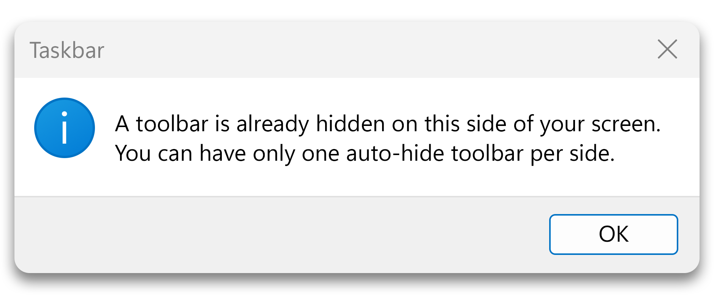
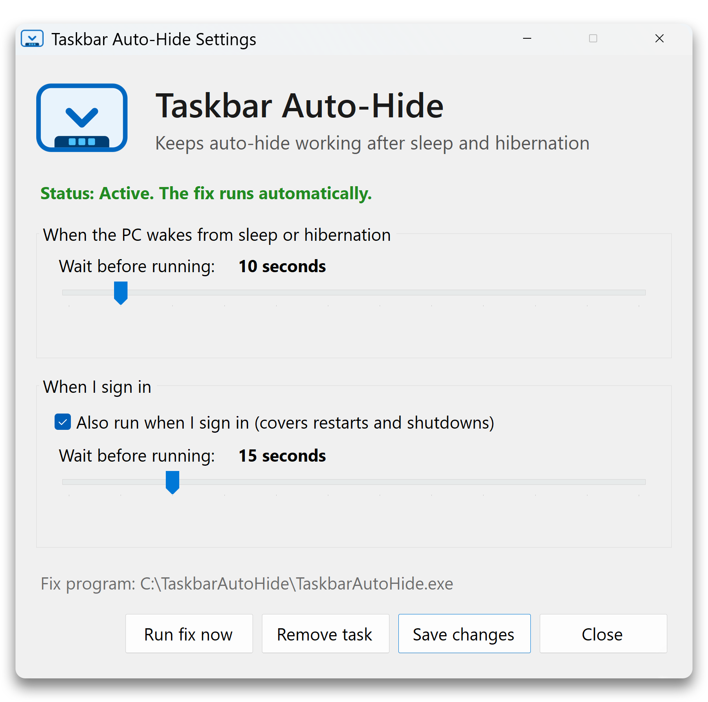

# Taskbar Auto-Hide

On Windows 11 with more than one monitor, waking the PC from sleep or hibernation
can show this error:

After that, the taskbar stops auto-hiding until you go to Settings > Personalization >
Taskbar and uncheck and recheck "Automatically hide the taskbar". This tool does that
for you.

## What's included

**TaskbarAutoHide.exe** turns auto-hide off and back on, then exits. Run this if you just want to fix the issue once. Next time the error pops up, run this again. It has no window and just fixes the issue and exits.

**TaskbarAutoHideSettings.exe** creates a scheduled task that runs the fix
automatically after the PC wakes up, and optionally when you sign in. You can set a delay for the fix in case your monitors take a while to connect. The default settings should be fine for most people. You can also use it to update or remove the task, or to just run the fix instantly once.

## Installation

1. [Download the latest release](https://github.com/achintyagk/TaskbarAutoHide/releases/latest)
   and extract it to a permanent folder, such as `C:\TaskbarAutoHide`. Keep both
   .exe files together.
2. Run TaskbarAutoHideSettings.exe, choose your delays and click **Create task**.

If you move the folder later, run TaskbarAutoHideSettings.exe again and click
**Save changes** so the task points to the new location.

Windows may show a SmartScreen warning the first time you run either program. Click **More info**, then **Run anyway**.

If you'd rather not, you can build the programs yourself (see below).

## Uninstallation

Run TaskbarAutoHideSettings.exe, click **Remove task**, then delete the folder.

## Requirements

Windows 11. The programs use .NET Framework 4.8 or later, which is included with Windows.

## Building from source

Run `build.bat`. It uses the C# compiler that comes with the .NET Framework, so
nothing needs to be installed. It will create the two .exe files in the same folder as the .bat file.

## License

GPL-3.0. See [LICENSE](LICENSE).
